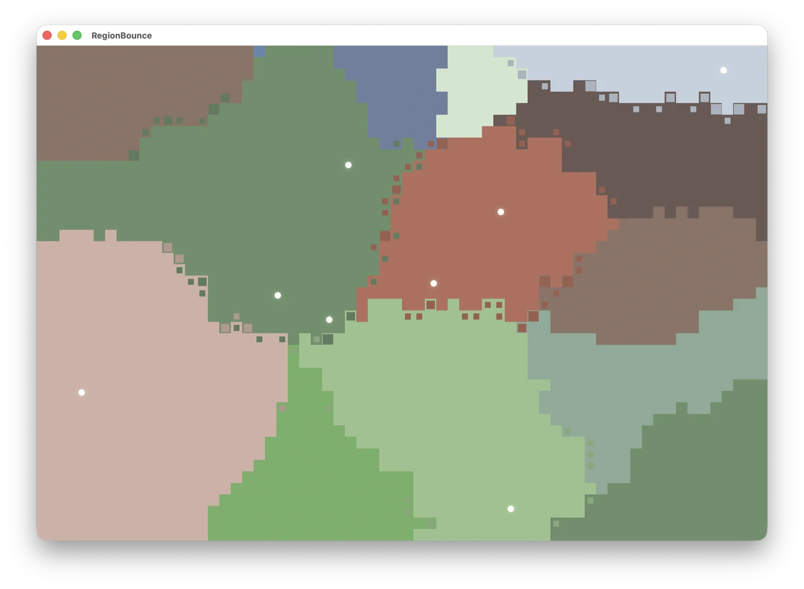

# RegionBounce

RegionBounce is a native macOS screen saver where three moving balls take over a randomized pixel map. Each ball carries the color of its starting pixel. When it hits a foreign boundary, that square immediately changes to the ball's color.

Every world begins as a noisy field of independently randomized colors. Over time, the three active ball colors erase all of the inactive starting colors and grow into larger territories.



## Features

- Native universal `arm64` and `x86_64` `.saver` bundle
- Optional **RegionBounce Preview** app with shared screen saver settings, **World → New World** (`⌘N`) and full-screen mode
- Independently randomized starting pixels, matching the visual behavior of Bounceorama
- Exactly three balls carrying three distinct starting colors
- Immediate single-pixel conversion on every boundary collision
- Equal-size square cells across the entire map, with edge pixels clipped rather than stretched
- Dark appearance by default, with dim territories and black balls
- Switch brightness in screen saver settings or **World → Dark Appearance** (`⌘D`) in the preview app
- Four palettes: Earth, Sorbet, Ocean, and Monochrome
- Screen saver settings for starting colors, grid size, speed, automatic reseeding, and ball visibility
- Deterministic, platform-independent C++ simulation with takeover and lifecycle tests
- Silent operation, suitable for a screen saver

## Build

RegionBounce requires macOS 12 or newer, Xcode command-line tools, and CMake 3.21 or newer.

```sh
./scripts/build-release.sh
```

This builds and tests both bundles, ad-hoc signs them for local use, verifies their signatures, and creates `dist/RegionBounce-macOS.zip`.

To run the preview app:

```sh
open "build-release/RegionBounce Preview.app"
```

To install the screen saver, open `build-release/RegionBounce.saver` in Finder or double-click it and let macOS add it to **System Settings → Screen Saver**. Local ad-hoc signing is intended for development; downloadable releases should be Developer ID signed and notarized.

## Preview and settings

The screen saver is the primary product. **RegionBounce Preview** is an optional
standalone companion for trying the animation without starting the screen saver.
Open **RegionBounce Preview → Settings…** (`⌘,`) to use the same settings panel
as the screen saver. Saving in either place updates the same preferences;
Cancel discards edits. **World → Dark Appearance** (`⌘D`) also saves the shared
appearance setting.

The preview reloads preferences when it becomes active. The screen saver reloads
when its animation starts; restart an already-running screen saver to pick up
changes from the preview. Existing installed screen saver settings are preserved.

The release archive includes the screen saver, optional preview app, and
[installation instructions](docs/INSTALL.txt).

## Repository structure

This repository contains one native macOS project with two bundle targets. It
does not contain a web app; the web experiment linked below is the inspiration.

- `src/simulation/`: platform-independent C++ world and collision logic.
- `src/macos/RegionBounceCanvasView.*`: shared native renderer and animation state.
- `src/macos/RegionBounceSettings.*`: shared defaults and saved preferences.
- `src/macos/RegionBounceSettingsController.*`: settings panel used by both bundles.
- `src/macos/RegionBounceSaverView.mm`: macOS screen saver lifecycle adapter.
- `src/macos/RegionBounceAppDelegate.*` and `main.mm`: optional preview app.
- `macos/`: bundle metadata; `scripts/`: release packaging; `tests/`: automated checks.

## How it works

1. Every square is assigned an independently randomized color; the generator guarantees that each configured starting color appears.
2. Three distinct colors are selected, and one ball spawns on a matching pixel for each color.
3. A ball bounces when its leading edge encounters another color, immediately converting that one boundary pixel.
4. The inactive colors have no balls, so they can only shrink. Eventually the map contains only the three ball colors.
5. The map is drawn as equal-size squares. It slightly overscans and clips the top and bottom edge when the viewport's aspect ratio does not divide evenly.
6. The world is regenerated after the configured interval.

## Inspiration

The interaction is inspired by [Keef U's 2021 Bounceorama experiment](https://x.com/keef_u/status/1390274784882085889) and its [interactive version](https://bounceorama.web.app/), which in turn credited [@jagarikin](https://x.com/jagarikin/status/1388660839205326851). RegionBounce is an independent native implementation with no source-code dependency on the web experiment.

## License

[MIT](LICENSE)
